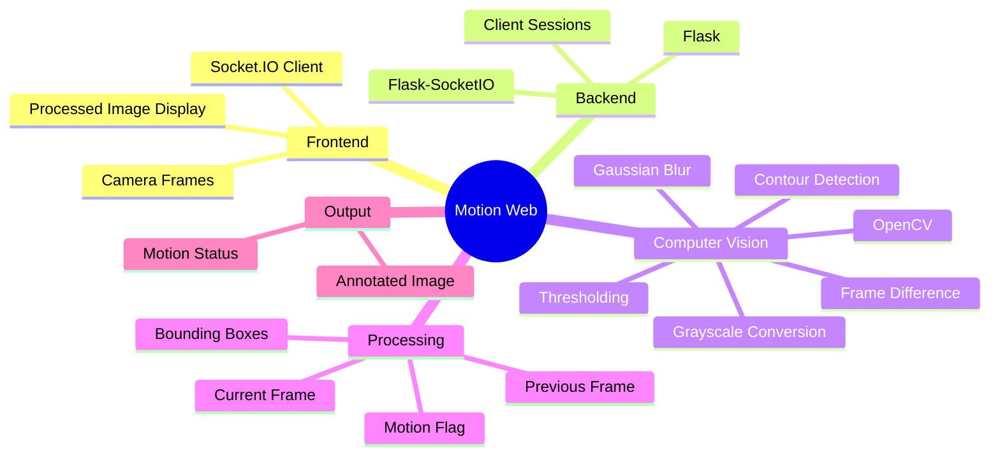
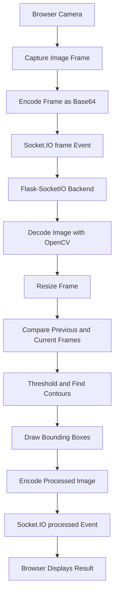
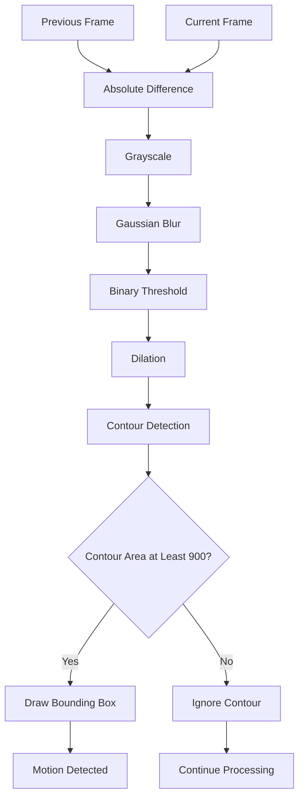

# Motion Web 👁️
### Real-Time Motion Detection with Flask, OpenCV and WebSockets

Motion Web is a browser-based computer vision application that processes video frames in real time to detect movement. Built with Python, Flask-SocketIO, and OpenCV, it compares consecutive camera frames, identifies moving regions, and returns annotated images to the connected client.

<p align="center">
  
  
  
  
  
</p>

<p align="center">
  <a href="https://github.com/Harinath125/motion_web">Source Code</a> •
  <a href="https://github.com/Harinath125/motion_web/issues">Report an Issue</a>
</p>

---

## 🚀 Overview

Motion Web explores how computer vision can be combined with real-time web communication to detect movement in camera frames.

Instead of sending a complete video file to a server, the application processes individual image frames. The backend compares the current frame with the previous frame for that client, highlights detected moving regions, and returns the processed image.

### Key features

- **Real-time frame processing** using Flask-SocketIO events.
- **Frame-difference motion detection** using OpenCV.
- **Image preprocessing** with grayscale conversion and Gaussian blur.
- **Noise reduction** through image thresholding and dilation.
- **Motion-region highlighting** using contour detection and bounding boxes.
- **Per-client frame tracking** using Socket.IO connection IDs.
- **Processed-frame streaming** back to the browser.
- **Configurable server port** through a command-line argument.

These features are implemented in the repository's `app.py`. <Cite refs={["turn274005view0"]}/>

## 🧠 Project Mind Map



## 🏗️ System Architecture



The browser-to-server flow uses image frames transmitted through Socket.IO. The backend maintains the previous frame separately for each connected client, allowing motion detection to compare successive frames from the same connection. <Cite refs={["turn274005view0"]}/>

## 🔬 How Motion Detection Works

The application uses a classical computer-vision technique called **frame differencing**.

<box gap={3}>
  <row align=start gap={3}>
    <AsyncImage query="security camera empty room still image indoor" aspectRatio="4:3" maxWidth="108px"/>
    <box flex="1" gap={1}>
      **1. Capture frames**

      Receive the current image and retain the preceding image for the same client.
    </box>
  </row>
  <divider color="subtle"/>
  <row align=start gap={3}>
    <AsyncImage query="computer vision image difference motion detection grayscale difference image" aspectRatio="4:3" maxWidth="108px"/>
    <box flex="1" gap={1}>
      **2. Calculate the difference**

      OpenCV computes the absolute pixel-wise difference between the two frames.
    </box>
  </row>
  <divider color="subtle"/>
  <row align=start gap={3}>
    <AsyncImage query="binary threshold computer vision motion detection white foreground black background" aspectRatio="4:3" maxWidth="108px"/>
    <box flex="1" gap={1}>
      **3. Reduce noise**

      The difference image is converted to grayscale, blurred, thresholded, and dilated.
    </box>
  </row>
  <divider color="subtle"/>
  <row align=start gap={3}>
    <AsyncImage query="computer vision motion detection red rectangular bounding boxes around moving person" aspectRatio="4:3" maxWidth="108px"/>
    <box flex="1" gap={1}>
      **4. Detect moving regions**

      Contours smaller than the configured area threshold are ignored. Larger regions receive bounding boxes, and the backend sets the motion flag.
    </box>
  </row>
</box>

The current implementation uses a contour-area threshold of 900 pixels and resizes incoming frames to a width of 640 pixels when necessary. These are implementation settings, not universal motion-detection thresholds. <Cite refs={["turn274005view0"]}/>

### Detection pipeline



## 🛠️ Technology Stack

| Technology | Purpose |
|---|---|
| Python | Backend application logic |
| Flask | Web application and page routing |
| Flask-SocketIO | Bidirectional event-based communication |
| Eventlet | Asynchronous server mode configured in the application |
| OpenCV | Image decoding, comparison, filtering, and contour detection |
| NumPy | Conversion of image bytes into arrays |
| Base64 | Transporting encoded image data |

These dependencies are listed in `requirements.txt`. <Cite refs={["turn274005view1"]}/>

## 📂 Repository Structure

```text
motion_web/
├── templates/
│   └── index.html
├── app.py
├── requirements.txt
├── Procfile
└── .gitignore
```

- `app.py` — Flask application, Socket.IO handlers, image conversion, and motion-detection pipeline.
- `templates/` — HTML templates served by Flask.
- `requirements.txt` — Python dependencies.
- `Procfile` — process-start configuration for compatible hosting environments.
- `.gitignore` — files excluded from version control.

## ⚙️ Getting Started

### Prerequisites

- Python 3
- pip
- Git
- A modern browser
- A webcam if the frontend uses live camera capture

### 1. Clone the repository

```bash
git clone https://github.com/Harinath125/motion_web.git
cd motion_web
```

### 2. Create a virtual environment

On macOS or Linux:

```bash
python3 -m venv .venv
source .venv/bin/activate
```

On Windows:

```bash
python -m venv .venv
.venv\Scripts\activate
```

### 3. Install dependencies

```bash
python -m pip install --upgrade pip
pip install -r requirements.txt
```

### 4. Start the application

```bash
python app.py
```

The application defaults to port `5000`. Open:

```text
http://localhost:5000
```

To specify a different port:

```bash
python app.py 8000
```

Then open `http://localhost:8000`.

**Note:** Successful motion detection also depends on the HTML template's camera-capture and Socket.IO client implementation. Check the browser console if the page loads but frames are not processed.

## 🔌 Socket.IO Event Flow

The backend uses two primary events:

| Event | Direction | Purpose |
|---|---|---|
| `frame` | Client → Server | Sends a Base64-encoded image frame |
| `processed` | Server → Client | Returns the annotated image and motion status |
| `error` | Server → Client | Reports an invalid frame payload |

The processed response includes the returned frame and a Boolean `motion` field. The application also removes a client's stored previous frame when that client disconnects. <Cite refs={["turn274005view0"]}/>

## 🧪 Testing and Validation

Try the following manual checks:

- [ ] Confirm the home page loads.
- [ ] Allow camera access if requested.
- [ ] Verify that image frames reach the backend.
- [ ] Keep the camera still and observe the output.
- [ ] Move an object in front of the camera.
- [ ] Confirm that detected regions receive bounding boxes.
- [ ] Connect multiple clients and verify that their frame histories remain separate.
- [ ] Disconnect a client and check that its stored frame is cleared.
- [ ] Test invalid frame payload handling.

These are recommended validation steps, not a claim that an automated test suite already exists.

## ⚠️ Current Limitations

- Frame differencing detects visual changes, not the meaning or identity of objects.
- Camera noise, shadows, lighting changes, and camera movement may trigger false positives.
- Small or slow-moving objects may not pass the contour-area threshold.
- Frames are Base64-encoded, which adds transmission overhead.
- Processing every incoming frame can increase CPU usage and latency.
- The current implementation stores previous frames in application memory.

## 🔐 Security and Deployment Considerations

Before exposing the application to the public internet:

- Replace permissive Socket.IO CORS settings with an explicit list of trusted origins.
- Add authentication and connection controls if access should be restricted.
- Validate incoming payload size and image format.
- Add rate limits and resource safeguards for frame processing.
- Use HTTPS/WSS in deployed environments.
- Avoid storing or logging camera images unnecessarily.
- Review the server configuration before deploying to a multi-worker environment.

The current code configures `cors_allowed_origins="*"`, so the application needs additional security review before public deployment. <Cite refs={["turn274005view0"]}/>

## 🗺️ Future Improvements

- [ ] Add a motion sensitivity control.
- [ ] Support adjustable contour-area thresholds.
- [ ] Add an explicit motion-status indicator in the UI.
- [ ] Improve performance with frame-rate and payload controls.
- [ ] Add automated tests for image processing.
- [ ] Add configurable camera and image settings.
- [ ] Add structured logging and error monitoring.
- [ ] Document production deployment and scaling requirements.
- [ ] Evaluate background-subtraction methods for more challenging scenes.

These are potential enhancements rather than existing features.

## 👨‍💻 Author

**Rayala Harinath**

GitHub: [@Harinath125](https://github.com/Harinath125)

---

<p align="center">
  <b>Motion Web</b><br/>
  Turning consecutive video frames into real-time motion insights.
</p>
